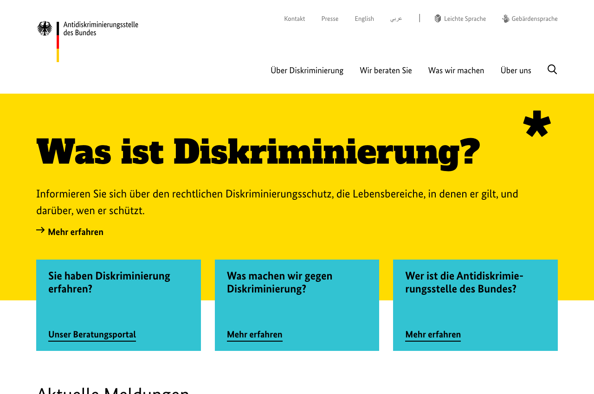
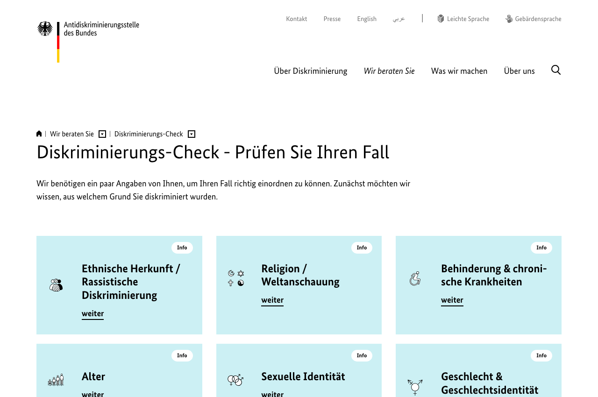
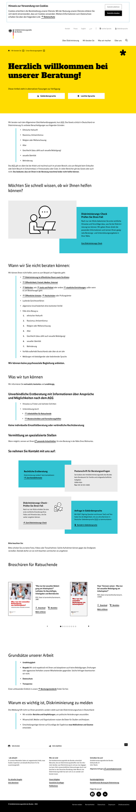
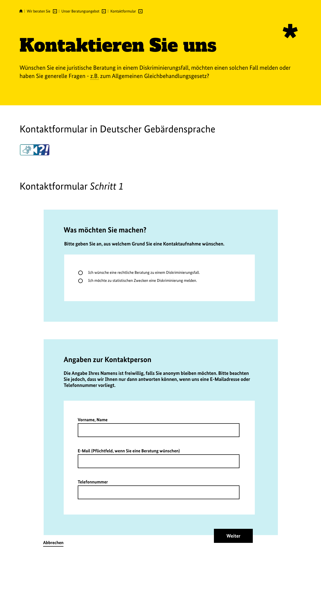
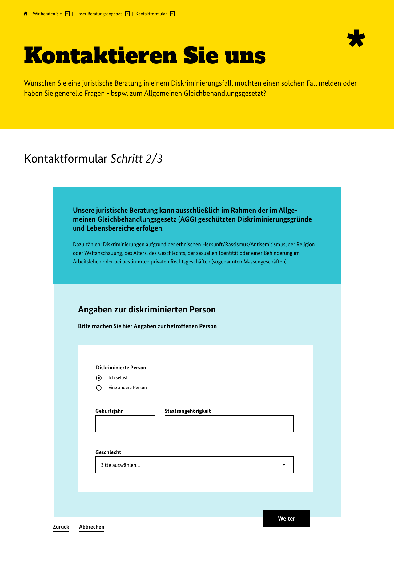
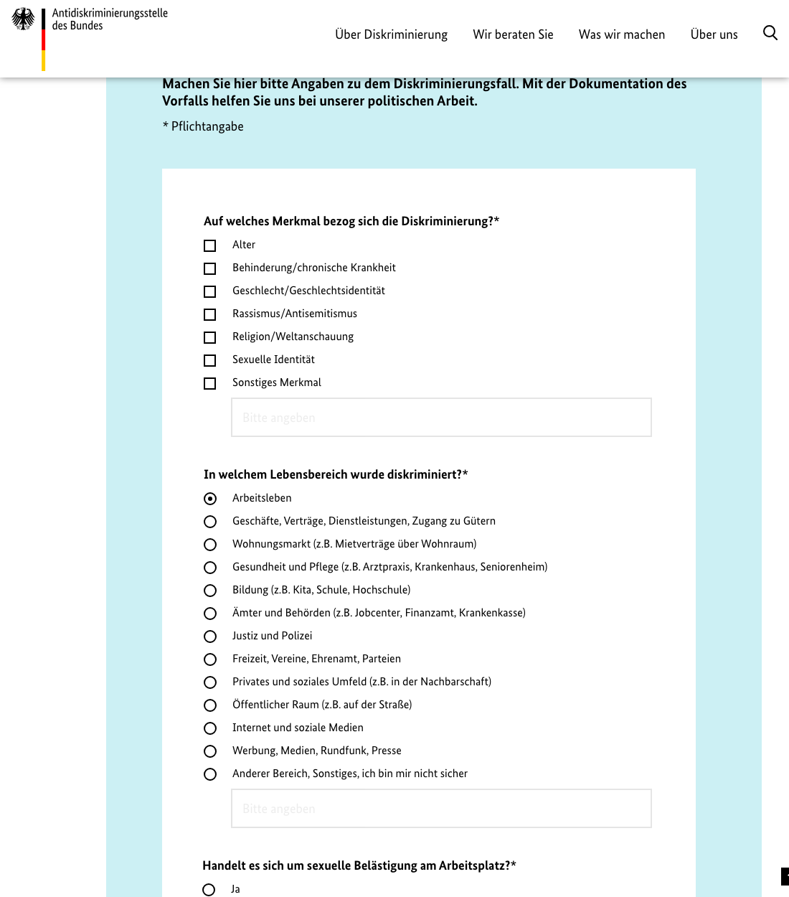
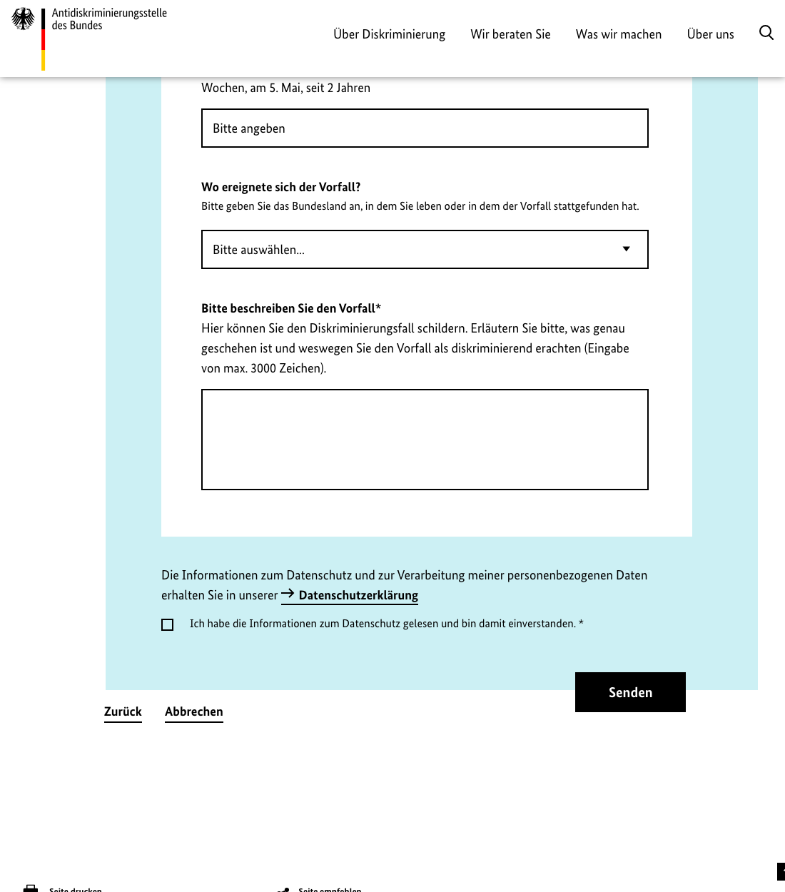

# Filing a Discrimination Complaint with the Antidiskriminierungsstelle des Bundes

### Diskriminierung melden bei der Antidiskriminierungsstelle des Bundes

A plain-language, click-by-click guide for the general public. Deutsch und English.

**Printable PDF.** [Download the full guide as a PDF](Discrimination-Complaint-Guide-ADS.pdf)

Website covered. www.antidiskriminierungsstelle.de
Guide prepared. 30 May 2026. The website can change over time, so the wording on screen may differ slightly from the screenshots.

## Why this guide exists / Warum es diese Anleitung gibt

**English**

Most people who experience discrimination in Germany never file anything. Not because they lack a case, but because the official website is dense and hard to read when you are upset, and many people do not even know that free, confidential federal help exists. This guide exists to change that. It turns the real filing process into calm, numbered steps with one screenshot per step, so a person who is stressed and short on time can still act, and act before the short legal deadline runs out.

**Deutsch**

Die meisten Menschen, die in Deutschland Diskriminierung erleben, melden sie nie. Nicht weil sie keinen Fall hätten, sondern weil die offizielle Webseite dicht und schwer zu lesen ist, wenn man aufgewühlt ist, und weil viele gar nicht wissen, dass es kostenlose, vertrauliche staatliche Hilfe gibt. Diese Anleitung soll das ändern. Sie macht aus dem echten Ablauf ruhige, nummerierte Schritte mit einem Screenshot pro Schritt, damit auch eine gestresste Person mit wenig Zeit handeln kann, und zwar bevor die kurze gesetzliche Frist abläuft.

## Read this first / Bitte zuerst lesen

**English**

The Antidiskriminierungsstelle des Bundes (ADS) is the German Federal Anti-Discrimination Agency. It offers a first-line legal consultation that is free, confidential, and independent. It gives you a first legal assessment, tells you what options you have, and points you to a local counseling center near you.

What the ADS does NOT do. It does not give binding legal advice, it does not represent you in court, and it does not handle your case for you long term. Think of it as the first door you knock on.

**Deutsch**

Die Antidiskriminierungsstelle des Bundes (ADS) ist die staatliche Stelle gegen Diskriminierung. Sie bietet eine rechtliche Erstberatung an. Diese ist kostenlos, vertraulich und unabhängig. Sie bekommen eine erste rechtliche Einschätzung, erfahren welche Möglichkeiten Sie haben, und werden bei Bedarf an eine Beratungsstelle in Ihrer Nähe weitervermittelt.

Was die ADS nicht macht. Sie gibt keine verbindliche Rechtsberatung, sie vertritt Sie nicht vor Gericht, und sie übernimmt Ihren Fall nicht dauerhaft. Sie ist die erste Anlaufstelle.

## The two-month deadline (the most important thing) / Die Zwei-Monats-Frist

**English**

If you want to claim compensation or damages because of discrimination at work, the law gives you a short window. Under section 15 paragraph 4 of the General Equal Treatment Act (AGG), a claim against an employer must be made in writing within two months. The two months start when you receive the rejection (for a job application or a promotion) or when you become aware of the discrimination (in other cases). A similar two-month written deadline applies to claims against a contract partner under section 21 paragraph 5 AGG.

What this means for you. Act quickly. Contact the ADS or a local counseling center as soon as possible, and put your claim in writing within two months so you do not lose your rights. Source. gesetze-im-internet.de, Allgemeines Gleichbehandlungsgesetz.

**Deutsch**

Wenn Sie wegen einer Diskriminierung am Arbeitsplatz Schadensersatz oder eine Entschädigung verlangen wollen, haben Sie nur wenig Zeit. Nach Paragraf 15 Absatz 4 AGG muss ein Anspruch gegenüber dem Arbeitgeber innerhalb von zwei Monaten schriftlich geltend gemacht werden. Die zwei Monate beginnen mit dem Zugang der Ablehnung (bei Bewerbung oder Beförderung) oder ab dem Zeitpunkt, an dem Sie von der Diskriminierung erfahren (in anderen Fällen). Eine ähnliche Zwei-Monats-Frist gilt nach Paragraf 21 Absatz 5 AGG bei Ansprüchen gegenüber einem Vertragspartner.

Das heißt für Sie. Handeln Sie schnell. Nehmen Sie so früh wie möglich Kontakt zur ADS oder zu einer Beratungsstelle auf und machen Sie Ihren Anspruch innerhalb von zwei Monaten schriftlich geltend, damit Sie Ihre Rechte nicht verlieren. Quelle. gesetze-im-internet.de, Allgemeines Gleichbehandlungsgesetz.

## What counts as discrimination here / Was hier als Diskriminierung zählt

The legal consultation only covers the grounds and life areas protected by the AGG.

**Protected grounds / Geschützte Merkmale**

- Ethnic origin, racism, antisemitism / Ethnische Herkunft, Rassismus, Antisemitismus
- Gender and gender identity / Geschlecht und Geschlechtsidentität
- Religion or worldview / Religion oder Weltanschauung
- Disability or chronic illness / Behinderung oder chronische Krankheit
- Age / Alter
- Sexual identity / Sexuelle Identität

**Protected life areas / Geschützte Lebensbereiche**

- Working life / Arbeitsleben
- Certain everyday private transactions, for example shopping, restaurants, gyms, housing rental / Bestimmte private Alltagsgeschäfte, zum Beispiel Einkaufen, Gastronomie, Fitnessstudio, Wohnungsmiete

If your case is in another area, you can still report it. The ADS records it for its statistical and political work and tries to refer you to a fitting counseling center, but the legal consultation itself stays within the AGG scope.

Wenn Ihr Fall in einem anderen Bereich liegt, können Sie ihn trotzdem melden. Die ADS dokumentiert ihn für ihre statistische und politische Arbeit und vermittelt Sie wenn möglich an eine passende Beratungsstelle weiter. Die rechtliche Beratung selbst bleibt aber im Rahmen des AGG.

## Before you start, get these ready / Bevor Sie anfangen, legen Sie das bereit

**English**

- The date and place where it happened
- Who was involved (employer, company, landlord, authority, person)
- Why you believe it was because of one of the protected grounds above
- Any evidence. Emails, letters, screenshots, photos, names of witnesses
- An email address where the ADS can reach you

Keep copies of everything. Do not send originals.

**Deutsch**

- Datum und Ort des Vorfalls
- Wer beteiligt war (Arbeitgeber, Firma, Vermieter, Behörde, Person)
- Warum Sie glauben, dass es wegen eines der oben genannten Merkmale war
- Beweise. E-Mails, Briefe, Screenshots, Fotos, Namen von Zeuginnen und Zeugen
- Eine E-Mail-Adresse, unter der die ADS Sie erreichen kann

Bewahren Sie Kopien von allem auf. Schicken Sie keine Originale.

## Step 0 (optional). Open the website / Die Webseite öffnen

**English**

Go to **www.antidiskriminierungsstelle.de**. In the top menu, click **"Wir beraten Sie"** (We advise you). Or, on the start page, click the first blue card **"Sie haben Diskriminierung erfahren?"** and then **"Unser Beratungsportal"**.

Note the buttons at the top right. **English**, **عربي** (Arabic), **Leichte Sprache** (easy German), and **Gebärdensprache** (sign language) give you other versions of the page.

**Deutsch**

Öffnen Sie **www.antidiskriminierungsstelle.de**. Klicken Sie im oberen Menü auf **"Wir beraten Sie"**. Oder klicken Sie auf der Startseite auf die erste blaue Kachel **"Sie haben Diskriminierung erfahren?"** und dann auf **"Unser Beratungsportal"**.

Oben rechts finden Sie **English**, **عربي** (Arabisch), **Leichte Sprache** und **Gebärdensprache** für andere Fassungen der Seite.

## Step 0b (optional). Check your case first / Prüfen Sie zuerst Ihren Fall

**English**

If you are unsure whether your case is covered, use the **Diskriminierungs-Check** (the page titled "Diskriminierungs-Check, Prüfen Sie Ihren Fall"). After a few clicks it gives you first legal pointers and tells you what you can do. It is a fast way to understand your situation before you fill in the full form. This step is optional. You can also go straight to the contact form in Step 1.

**Deutsch**

Wenn Sie nicht sicher sind, ob Ihr Fall erfasst ist, nutzen Sie den **Diskriminierungs-Check** (Seite "Diskriminierungs-Check, Prüfen Sie Ihren Fall"). Nach wenigen Klicks bekommen Sie erste rechtliche Hinweise und erfahren, was Sie tun können. So verstehen Sie Ihre Lage schnell, bevor Sie das ganze Formular ausfüllen. Dieser Schritt ist freiwillig. Sie können auch direkt zum Kontaktformular in Schritt 1 gehen.

## The counseling page / Die Beratungsseite

**English**

On the page **"Unser Beratungsangebot"** you see the ways to reach the ADS. The main route is the contact form. Click the button **"Zum Kontaktformular"**.

Other ways to reach the agency.

- Email for general questions. poststelle@ads.bund.de
- Fax. 030 18 555 41865
- Post for counseling requests. Servicebüro der Antidiskriminierungsstelle des Bundes beim Bundesamt für Familie und zivilgesellschaftliche Aufgaben, 50964 Köln

Direct link to the form. www.antidiskriminierungsstelle.de/DE/wir-beraten-sie/jetzt-kontakt-aufnehmen/kontaktformular/Seite_1/_node.html

**Deutsch**

Auf der Seite **"Unser Beratungsangebot"** sehen Sie die Wege zur ADS. Der Hauptweg ist das Kontaktformular. Klicken Sie auf **"Zum Kontaktformular"**.

Weitere Wege zur ADS.

- E-Mail für allgemeine Anfragen. poststelle@ads.bund.de
- Fax. 030 18 555 41865
- Post für Beratungsanfragen. Servicebüro der Antidiskriminierungsstelle des Bundes beim Bundesamt für Familie und zivilgesellschaftliche Aufgaben, 50964 Köln

Direkter Link zum Formular. www.antidiskriminierungsstelle.de/DE/wir-beraten-sie/jetzt-kontakt-aufnehmen/kontaktformular/Seite_1/_node.html

## Step 1. What do you want, and your contact details / Schritt 1. Ihr Anliegen und Ihre Kontaktdaten

**English**

The form has three steps. On step 1 you do two things.

1. Under **"Was möchten Sie machen?"** choose one option.
   - **"Ich wünsche eine rechtliche Beratung zu einem Diskriminierungsfall."** Choose this if you want help and an answer. This is the normal choice.
   - **"Ich möchte zu statistischen Zwecken eine Diskriminierung melden."** Choose this only if you want to report the case for the statistics and do not need a reply.
2. Under **"Angaben zur Kontaktperson"** fill in your details.
   - **"Vorname, Name"**. Your name. This is optional, you may stay anonymous.
   - **"E-Mail"**. Your email. This is required if you want a consultation, because the ADS answers by email.
   - **"Telefonnummer"**. Your phone number. Optional.
3. Click **"Weiter"** (Next).

**Deutsch**

Das Formular hat drei Schritte. In Schritt 1 machen Sie zwei Dinge.

1. Unter **"Was möchten Sie machen?"** wählen Sie eine Option.
   - **"Ich wünsche eine rechtliche Beratung zu einem Diskriminierungsfall."** Wählen Sie das, wenn Sie Hilfe und eine Antwort möchten. Das ist die übliche Wahl.
   - **"Ich möchte zu statistischen Zwecken eine Diskriminierung melden."** Wählen Sie das nur, wenn Sie den Fall lediglich für die Statistik melden und keine Antwort brauchen.
2. Unter **"Angaben zur Kontaktperson"** tragen Sie Ihre Daten ein.
   - **"Vorname, Name"**. Ihr Name. Freiwillig, Sie können anonym bleiben.
   - **"E-Mail"**. Ihre E-Mail. Pflicht, wenn Sie eine Beratung wünschen, denn die ADS antwortet per E-Mail.
   - **"Telefonnummer"**. Ihre Telefonnummer. Freiwillig.
3. Klicken Sie auf **"Weiter"**.

## Step 2. Who was affected / Schritt 2. Wer ist betroffen

**English**

Step 2 is titled **"Angaben zur diskriminierten Person"** (details about the affected person). The blue box reminds you that the legal consultation only covers AGG-protected grounds.

1. Under **"Diskriminierte Person"** choose **"Ich selbst"** (myself) or **"Eine andere Person"** (another person).
2. The fields below are optional. Fill them only if you want.
   - **"Geburtsjahr"**. Year of birth.
   - **"Staatsangehörigkeit"**. Nationality.
   - **"Geschlecht"**. Gender, from the drop-down.
3. Click **"Weiter"** (Next).

**Deutsch**

Schritt 2 heißt **"Angaben zur diskriminierten Person"**. Der blaue Kasten erinnert daran, dass die rechtliche Beratung nur die im AGG geschützten Merkmale abdeckt.

1. Unter **"Diskriminierte Person"** wählen Sie **"Ich selbst"** oder **"Eine andere Person"**.
2. Die Felder darunter sind freiwillig. Füllen Sie sie nur aus, wenn Sie möchten.
   - **"Geburtsjahr"**.
   - **"Staatsangehörigkeit"**.
   - **"Geschlecht"** aus der Auswahlliste.
3. Klicken Sie auf **"Weiter"**.

## Step 3, part A. Ground and area / Schritt 3, Teil A. Merkmal und Lebensbereich

**English**

Step 3 is titled **"Angaben zum Diskriminierungsvorfall"** (details about the incident). The star symbol marks required fields.

1. Under **"Auf welches Merkmal bezog sich die Diskriminierung?"** tick one or more boxes for the ground.
   - Alter (age), Behinderung/chronische Krankheit (disability/chronic illness), Geschlecht/Geschlechtsidentität (gender/gender identity), Rassismus/Antisemitismus (racism/antisemitism), Religion/Weltanschauung (religion/worldview), Sexuelle Identität (sexual identity), or Sonstiges Merkmal (other, with a free text box).
2. Under **"In welchem Lebensbereich wurde diskriminiert?"** choose one area, for example **"Arbeitsleben"** (working life), **"Wohnungsmarkt"** (housing), **"Ämter und Behörden"** (offices and authorities), and so on.

**Deutsch**

Schritt 3 heißt **"Angaben zum Diskriminierungsvorfall"**. Das Sternchen kennzeichnet Pflichtfelder.

1. Unter **"Auf welches Merkmal bezog sich die Diskriminierung?"** setzen Sie ein oder mehrere Häkchen beim passenden Merkmal.
   - Alter, Behinderung/chronische Krankheit, Geschlecht/Geschlechtsidentität, Rassismus/Antisemitismus, Religion/Weltanschauung, Sexuelle Identität, oder Sonstiges Merkmal (mit Freitextfeld).
2. Unter **"In welchem Lebensbereich wurde diskriminiert?"** wählen Sie einen Bereich, zum Beispiel **"Arbeitsleben"**, **"Wohnungsmarkt"**, **"Ämter und Behörden"** und so weiter.

## Step 3, part B. Describe the incident and send / Schritt 3, Teil B. Vorfall beschreiben und senden

**English**

3. **"Handelt es sich um eine sexuelle Belästigung am Arbeitsplatz?"** (Is this sexual harassment at work?) Choose **"Ja"** or **"Nein"**.
4. **"Wann ereignete sich der Vorfall?"** Write roughly when it happened, for example "vor 2 Wochen" (two weeks ago), "am 5. Mai", or "seit 2 Jahren" (for two years).
5. **"Wo ereignete sich der Vorfall?"** Choose your federal state (Bundesland) from the drop-down.
6. **"Bitte beschreiben Sie den Vorfall"** This is the main field, up to 3000 characters. Describe what happened and why you consider it discrimination. A good description includes.
   - What exactly happened, and what was said or done
   - The date, time, and place
   - Who was involved
   - Why you believe it was because of a protected ground
   - Whether there are witnesses or documents
7. Tick **"Ich habe die Informationen zum Datenschutz gelesen und bin damit einverstanden."** (I have read the data protection information and agree). This is required.
8. Click **"Senden"** (Send).

After sending, you receive a first legal assessment and pointers by email, and where possible a referral to a counseling center near you. Remember the two-month written deadline for AGG claims.

**Deutsch**

3. **"Handelt es sich um eine sexuelle Belästigung am Arbeitsplatz?"** Wählen Sie **"Ja"** oder **"Nein"**.
4. **"Wann ereignete sich der Vorfall?"** Geben Sie ungefähr an, wann es passiert ist, zum Beispiel "vor 2 Wochen", "am 5. Mai" oder "seit 2 Jahren".
5. **"Wo ereignete sich der Vorfall?"** Wählen Sie Ihr Bundesland aus der Liste.
6. **"Bitte beschreiben Sie den Vorfall"** Das ist das Hauptfeld, bis zu 3000 Zeichen. Schildern Sie, was passiert ist und warum Sie es als Diskriminierung empfinden. Eine gute Schilderung enthält.
   - Was genau passiert ist, und was gesagt oder getan wurde
   - Datum, Uhrzeit und Ort
   - Wer beteiligt war
   - Warum Sie glauben, dass es wegen eines geschützten Merkmals war
   - Ob es Zeugen oder Unterlagen gibt
7. Setzen Sie das Häkchen bei **"Ich habe die Informationen zum Datenschutz gelesen und bin damit einverstanden."** Das ist Pflicht.
8. Klicken Sie auf **"Senden"**.

Nach dem Absenden bekommen Sie per E-Mail eine erste rechtliche Einschätzung und Hinweise, und wenn möglich eine Vermittlung an eine Beratungsstelle in Ihrer Nähe. Denken Sie an die Zwei-Monats-Frist für AGG-Ansprüche.

## Quick reference. The whole flow / Kurzüberblick. Der ganze Ablauf

| Step | German label on screen | What you do |
|---|---|---|
| Start | Wir beraten Sie, Unser Beratungsangebot | Open the site, go to the counseling page |
| Form opens | Zum Kontaktformular | Open the contact form |
| 1 | Schritt 1 | Pick "rechtliche Beratung", enter email, click Weiter |
| 2 | Schritt 2/3 | Pick "Ich selbst", optional details, click Weiter |
| 3A | Schritt 3/3 | Tick the ground, pick the life area |
| 3B | Schritt 3/3 | Answer the harassment question, when, where, describe the incident |
| Consent | Datenschutz checkbox | Tick the data protection box |
| Send | Senden | Submit the form |

## If you need more than a first consultation / Wenn Sie mehr als eine Erstberatung brauchen

**English**

- Find a local counseling center through **"Andere Beratungsstellen finden"** on the ADS site. These centers can support you over a longer period.
- For a written claim against an employer or a contract partner, the ADS provides template letters (**"Musterschreiben und Formulierungshilfen"**) under section 15 paragraph 4 AGG and section 21 paragraph 5 AGG. Use them within the two-month deadline.
- For binding legal advice or court representation, contact a lawyer, ideally one for labour law or anti-discrimination law.

**Deutsch**

- Eine Beratungsstelle vor Ort finden Sie über **"Andere Beratungsstellen finden"** auf der ADS-Seite. Diese Stellen können Sie über einen längeren Zeitraum begleiten.
- Für eine schriftliche Geltendmachung gegenüber Arbeitgeber oder Vertragspartner bietet die ADS Musterschreiben (**"Musterschreiben und Formulierungshilfen"**) nach Paragraf 15 Absatz 4 AGG und Paragraf 21 Absatz 5 AGG. Nutzen Sie diese innerhalb der Zwei-Monats-Frist.
- Für eine verbindliche Rechtsberatung oder eine Vertretung vor Gericht wenden Sie sich an eine Anwältin oder einen Anwalt, am besten für Arbeitsrecht oder Antidiskriminierungsrecht.

## Authenticated resources for anyone who faced discrimination / Geprüfte Anlaufstellen

These are official or established resources in Germany. The links were checked on 30 May 2026.

**Report and get a first legal assessment / Melden und eine erste Einschätzung erhalten**

- Antidiskriminierungsstelle des Bundes, contact form. www.antidiskriminierungsstelle.de/DE/wir-beraten-sie/jetzt-kontakt-aufnehmen/kontaktformular/Seite_1/_node.html
- Diskriminierungs-Check, a quick self assessment. www.antidiskriminierungsstelle.de/DE/wir-beraten-sie/diskriminierungs-check/diskriminierungs-check-node.html
- General email of the agency. poststelle@ads.bund.de

**Find a local counseling center that can support you longer / Beratungsstelle vor Ort finden**

- Andere Beratungsstellen finden, the agency map of local counseling centers. www.antidiskriminierungsstelle.de/DE/wir-beraten-sie/andere_beratungsstellen_finden_advd/beratungsstellenlandkarte_advd_node.html

**Assert a written claim in time / Anspruch rechtzeitig schriftlich geltend machen**

- Musterschreiben und Formulierungshilfen, template letters under sections 13, 15, and 21 AGG. www.antidiskriminierungsstelle.de/DE/wir-beraten-sie/musterschreiben/agg_musterschreiben-node.html

**Find and pay for a lawyer / Anwältin oder Anwalt finden und bezahlen**

- Deutscher Anwaltverein lawyer finder, search by field of law such as labour law. www.anwaltauskunft.de
- Beratungshilfe (help with the cost of legal advice) and Prozesskostenhilfe (help with court costs) are available on a low income. Apply at your local Amtsgericht. Beratungshilfe und Prozesskostenhilfe beantragen Sie beim örtlichen Amtsgericht.

**If the discrimination involved harassment or violence / Bei Belästigung oder Gewalt**

- Hilfetelefon Gewalt gegen Frauen, free, anonymous, around the clock. Phone 116 016. www.hilfetelefon.de

**The law itself / Das Gesetz selbst**

- Allgemeines Gleichbehandlungsgesetz (AGG), full text. www.gesetze-im-internet.de/agg

**Inside a workplace / Im Betrieb**

- Many employers must run a complaint office under section 13 AGG (Beschwerdestelle). Your works council (Betriebsrat) or staff council (Personalrat) can also help. Viele Arbeitgeber müssen nach Paragraf 13 AGG eine Beschwerdestelle einrichten. Auch Betriebsrat oder Personalrat können helfen.

## When it is useful to reach out / Wann es sich lohnt, sich zu melden

**English**

Reach out sooner rather than later in these cases.

- A deadline is near. AGG claims against an employer must be in writing within two months. Do not wait.
- You want a second pair of eyes before you act. A counseling center or the agency gives a first assessment for free.
- The situation is ongoing or getting worse, for example continued harassment. Get support in parallel. You do not have to carry it alone.
- You are unsure whether your case is covered. Use the Diskriminierungs-Check or ask a counseling center.
- You need a binding legal step or court action. Contact a lawyer.

**Deutsch**

In diesen Fällen sollten Sie sich früher als später melden.

- Eine Frist ist nah. AGG-Ansprüche gegen den Arbeitgeber müssen innerhalb von zwei Monaten schriftlich erfolgen. Warten Sie nicht.
- Sie möchten Ihren Fall prüfen lassen, bevor Sie handeln. Eine Beratungsstelle oder die ADS gibt kostenlos eine erste Einschätzung.
- Die Lage dauert an oder wird schlimmer, zum Beispiel anhaltende Belästigung. Holen Sie sich parallel Unterstützung. Sie müssen das nicht allein tragen.
- Sie sind unsicher, ob Ihr Fall erfasst ist. Nutzen Sie den Diskriminierungs-Check oder fragen Sie eine Beratungsstelle.
- Sie brauchen einen verbindlichen rechtlichen Schritt oder eine Klage. Wenden Sie sich an eine Anwältin oder einen Anwalt.

## Where this comes from / Woher die Anleitung stammt

**English**

The steps, field names, and screenshots were documented directly from the official website of the Antidiskriminierungsstelle des Bundes (www.antidiskriminierungsstelle.de) on 30 May 2026. The two-month deadline and the legal sections (13, 15, and 21 AGG) were confirmed against the official statute at www.gesetze-im-internet.de/agg.

The screenshots show the public agency website so each step is easy to recognise. This repository is independent. It is not affiliated with, operated by, or endorsed by the Antidiskriminierungsstelle des Bundes. If a rights holder wants a screenshot removed, please open an issue.

**Deutsch**

Die Schritte, Feldnamen und Screenshots wurden am 30. Mai 2026 direkt von der offiziellen Webseite der Antidiskriminierungsstelle des Bundes (www.antidiskriminierungsstelle.de) dokumentiert. Die Zwei-Monats-Frist und die Paragrafen 13, 15 und 21 AGG wurden anhand des amtlichen Gesetzestextes auf www.gesetze-im-internet.de/agg geprüft.

Die Screenshots zeigen die öffentliche Webseite der Behörde, damit jeder Schritt leicht wiederzuerkennen ist. Dieses Repository ist unabhängig. Es steht in keiner Verbindung zur Antidiskriminierungsstelle des Bundes und wird von ihr weder betrieben noch unterstützt. Wenn ein Rechteinhaber einen Screenshot entfernt haben möchte, öffnen Sie bitte ein Issue.

## Feedback and corrections / Rückmeldung und Korrekturen

**English**

This guide stays useful only if it stays accurate. If a step is wrong, a label on the website changed, or something is unclear, please open an issue on this repository so it can be fixed for the next person. Corrections, sharper wording, and new translations are welcome. If you are filing your own case and a step does not match what you see on screen, that mismatch is worth reporting too. It usually means the website changed and the guide needs an update.

**Deutsch**

Diese Anleitung bleibt nur nützlich, wenn sie aktuell bleibt. Wenn ein Schritt falsch ist, sich eine Bezeichnung auf der Webseite geändert hat oder etwas unklar ist, öffnen Sie bitte ein Issue in diesem Repository, damit es für die nächste Person verbessert wird. Korrekturen, bessere Formulierungen und neue Übersetzungen sind willkommen. Wenn Sie Ihren eigenen Fall einreichen und ein Schritt nicht zu dem passt, was Sie auf dem Bildschirm sehen, ist auch das einen Hinweis wert. Meist bedeutet es, dass sich die Webseite geändert hat und die Anleitung aktualisiert werden muss.

## License / Lizenz

This guide is published under Creative Commons Attribution 4.0 International (CC BY 4.0). You may share, translate, and republish it for free, including commercially, as long as you credit this repository and keep the source links. Full text in the LICENSE file.

Diese Anleitung steht unter Creative Commons Namensnennung 4.0 International (CC BY 4.0). Sie dürfen sie kostenlos teilen, übersetzen und erneut veröffentlichen, auch kommerziell, solange Sie dieses Repository nennen und die Quellenlinks erhalten. Volltext in der Datei LICENSE.

This guide is informational and is not legal advice. Diese Anleitung ist eine Information und keine Rechtsberatung.
